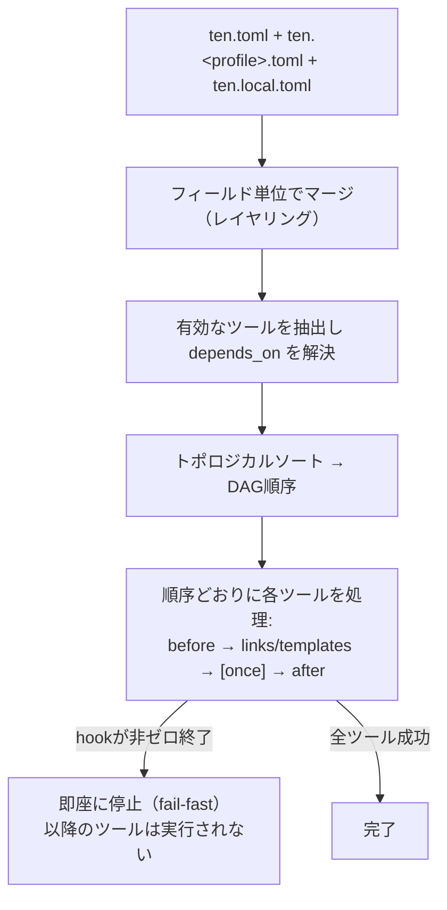
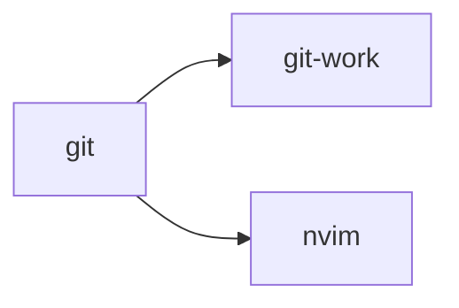
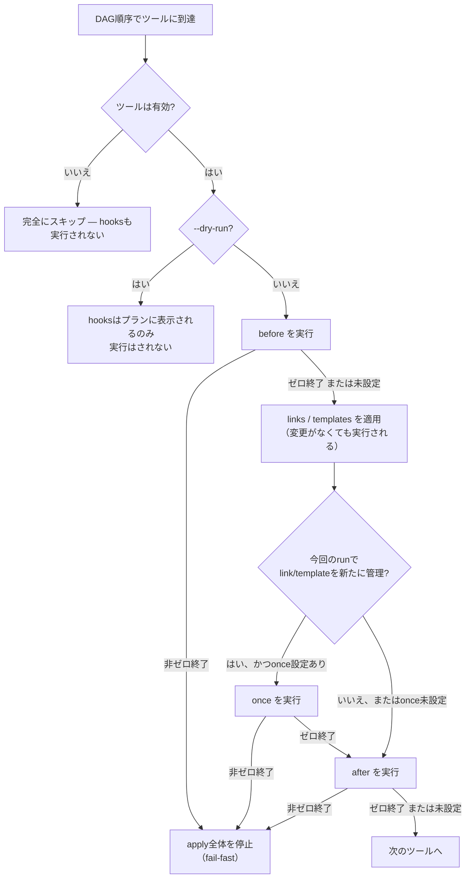

# applyの仕組み

[English](apply.md) | 日本語

`ten apply` は設定を解決し、依存関係でツールを並べ替えたうえで、その順序で各ツールのhooksとリソースを実行します:

設定だけからは分かりにくい点:

- **hooksは有効なツールに対して必ず実行される** — `links`/`templates` に実際の変更があったかどうかに関わらず、リソースを持たずhooksだけを定義しているツールでも実行される。
- **hookが失敗すると実行全体が停止する。** `before`・`once`・`after` のいずれかが非ゼロ終了すると、`ten apply` は即座に停止する — DAG順序で後にあるツールは一切実行されない。
- **`once` はツールごとに最大1回だけ発火する。** 今回のrunでそのツールが `links`/`templates` の対象を新たに管理する場合(＝`ten.state.json` に未登録だった場合)にのみ実行される。`links`/`templates` を持たないツールでは発火しない。`once` フック自体が失敗した場合、対象は `ten.state.json` に記録されないため、次回の `ten apply` で `once` は再び発火する(セットアップコマンドが静かに失われることはない)。
- **変更のないリソースには触れない。** すでに正しいシンボリックリンクと、描画結果がディスク上の内容と一致するテンプレートは `up to date` と表示され、書き直されない(mtimeも変わらない)。

この処理の前に設定ファイルがどうマージされるかは[設定のレイヤリング](../reference/configuration.ja.md#設定のレイヤリング)を参照してください。

## 依存関係の順序

`depends_on` はトポロジカルソートでツールを並べます: あるツールは、それが依存するものすべてのあとに必ず適用されます。例えば `git-work` が `git` に依存している場合、適用順序は次のようになります:

`git` が最初に適用され、`git-work` と `nvim` はそのあとに適用されます（両者の相対的な順序は未規定です）。あるツールの `depends_on` が無効化されたツールを指している場合、`ten apply` は黙ってスキップせずエラーになります — 依存先を有効にするか、`depends_on` から取り除いてください。

## hookの実行

hooksは `sh -c` 経由で、`ten apply` をどこから実行したかに関わらず、dotfilesリポジトリを作業ディレクトリとして実行されます。`before` と `after` は、有効な各ツールに対してDAG順序で無条件に実行されます — そのツールのリソースに変更がなくても、`links`/`templates` を持たずhooksだけを定義しているツールでも実行されます。`once` は、今回のrunでそのツールが `links`/`templates` の対象を新たに管理する場合(＝run開始時点で `ten.state.json` に未登録だった場合)にのみ実行されます — シンボリックリンク/テンプレート操作自体がno-opだったかどうかとは独立しており、`links`/`templates` を持たないツールでは発火しません。`--dry-run` では、hooksはプランに表示されるだけで実行されません(`once` の発火判定自体はstateだけを見るため、この判定ロジックはdry-runでも変わりません)。`before`・`once`・`after` のいずれかが非ゼロ終了すると `ten apply` は即座に停止します。DAG順序で後にあるツールは実行されません。
