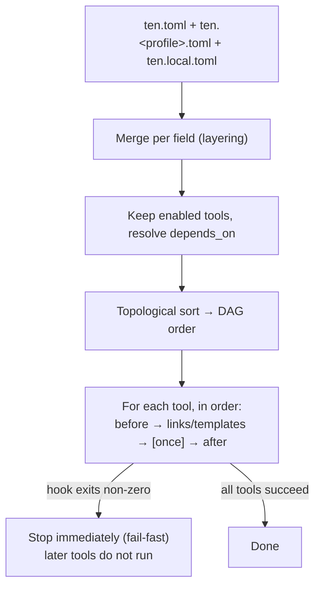
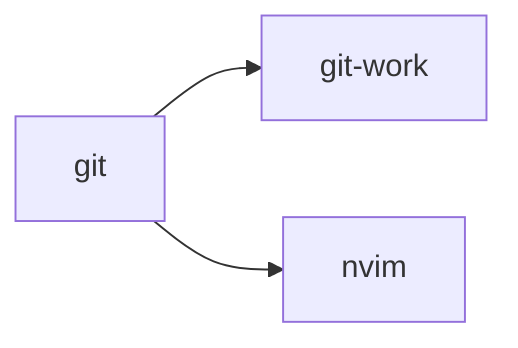
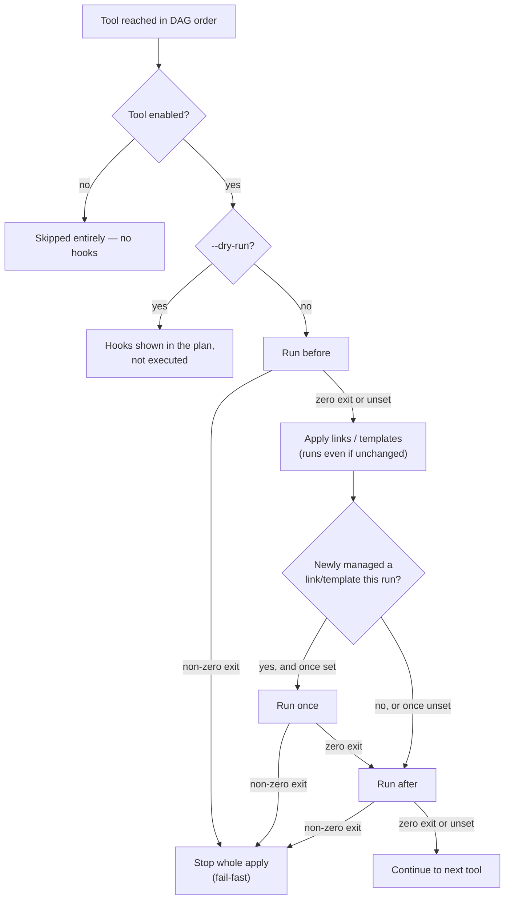

# How apply works

English | [日本語](apply.ja.md)

`ten apply` resolves your config, orders tools by their dependencies, then runs each tool's hooks and resources in that order:

A few details that aren't obvious from the config alone:

- **Hooks always run for an enabled tool**, regardless of whether its `links`/`templates` actually changed, and even if the tool defines only hooks with no resources at all.
- **A failing hook stops the whole run.** If `before`, `once`, or `after` exits non-zero, `ten apply` stops immediately — tools later in DAG order never run.
- **`once` fires at most once per tool.** It runs only when this apply run causes the tool to newly manage a `links`/`templates` target that wasn't already recorded in `ten.state.json`; it never fires for a tool with no `links`/`templates`. If the `once` hook itself fails, the targets it would have covered are not recorded, so the next `ten apply` fires `once` again rather than silently losing the setup command.
- **Unchanged resources are left untouched.** An already-correct symlink and a template whose rendered output equals what is already on disk are shown as `up to date` and not rewritten (no mtime churn).

How the config files are merged before this runs is covered in [Config layering](../reference/configuration.md#config-layering).

## Dependency order

`depends_on` orders tools with a topological sort: a tool always applies after everything it depends on. For example, `git-work` depending on `git` gives this apply order:

`git` applies first; `git-work` and `nvim` apply after it (their relative order to each other is unspecified). If a tool's `depends_on` names a tool that ends up disabled, `ten apply` errors instead of silently skipping it — enable the dependency or remove it from `depends_on`.

## Hook execution

Hooks run through `sh -c` with the dotfiles repository as their working directory, regardless of where `ten apply` was invoked. `before` and `after` run unconditionally for every enabled tool, in DAG order — even when the tool's resources didn't change, and even for a tool with hooks but no `links`/`templates`. `once` runs only when this apply run causes the tool to newly manage at least one `links`/`templates` target — one that wasn't already recorded in `ten.state.json` when the run started; it is independent of whether the underlying symlink/template operation was itself a no-op, and it never fires for a tool with no `links`/`templates`. Under `--dry-run`, hooks are shown in the plan but never executed (the `once` eligibility check itself still runs, since it only reads state, not the filesystem). A non-zero exit from `before`, `once`, or `after` stops `ten apply` immediately; tools later in DAG order do not run.
