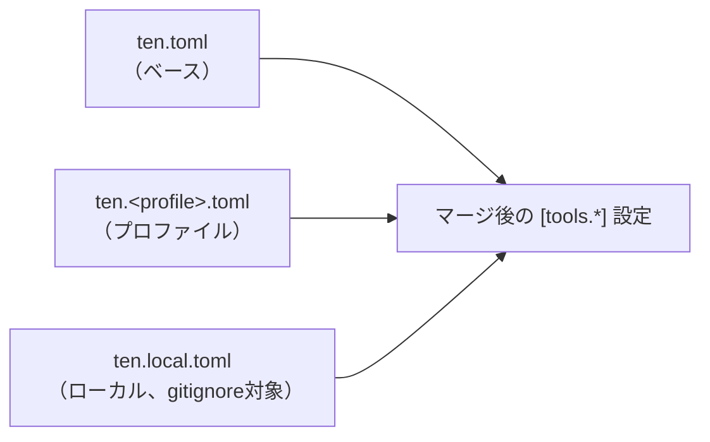

# 設定リファレンス

[English](configuration.md) | 日本語

## ターゲットパスのプレフィックス

`links` / `templates` のキーは、次のいずれかのプレフィックスを使って絶対パスに解決されます:

- `home:` → `$HOME` 配下
- `xdg:` → `$XDG_CONFIG_HOME` 配下（フォールバック先: `$HOME/.config`）

## `[tools.*]`

```toml
[tools.git-work]
enabled    = false                                                   # 省略時のデフォルトは true
depends_on = ["git"]                                                 # 依存先のあとに、DAG順序で適用される
links     = { "home:.gitconfig" = "git/.gitconfig" }                 # シンボリックリンク
templates = { "home:.gitconfig.local" = "git/gitconfig.local.tmpl" } # text/template で描画される（{{ .Vars.key }} / {{ .Ten.OS }}）
before = "echo before"                                                # このツールのリソースより前に実行するシェルコマンド
once   = "echo once"                                                  # このツールが link/template を新たに管理した最初の1回だけ実行するシェルコマンド
after  = "echo after"                                                 # あとに実行するシェルコマンド
```

`depends_on` によるツールの並び順と、各hookがいつ実行されるかは[applyの仕組み](../concepts/apply.ja.md)を参照してください。

次の3つの安全チェックに引っかかると、apply は最初に失敗します:

- **未定義のテンプレート変数はエラー。** どのレイヤーにも定義されていない `.Vars` キーを参照するテンプレートは、`<no value>` を黙って書き込む代わりに失敗します。`{{ if .Vars.optional }}` のような未宣言キーへの分岐も同様です — 分岐に使うキーは(空文字列でもよいので)いずれかのレイヤーで宣言してください。
- **ターゲットの重複はエラー。** 同じターゲットパスに解決されるエントリが2つある場合(別々のツール間でも、1つのツールの `links` と `templates` の間でも)、両者の名前を挙げて拒否されます。
- **ターゲットの入れ子はエラー。** 管理対象のターゲットの配下に別のターゲットを置くことはできません(例: ディレクトリとしてリンクした `xdg:nvim` と、`xdg:nvim/local.lua` へのテンプレート)。外側のターゲットがリポジトリへのシンボリックリンクになると、内側のパスはリポジトリ自体の中を指してしまうためです。

テンプレートの出力はデフォルトで所有者のみ読み書き可能です: 新規に作成されるテンプレート出力のモードは `0600` です(テンプレートは `vars` 由来のマシン固有の値、しばしば秘密情報を含むため)。既存の通常ファイルを置き換え・更新する場合は、そのファイルの所有者の権限ビットだけを引き継ぎ、group/other の権限ビットは常に落とします(旧バージョンの ten が `0644` で書いた出力も、内容に変更がなくても締められます)。書き込みは一時ファイル＋renameで原子的に行われます。

## テンプレートで使える値

テンプレートはGoの `text/template` で描画され、次の2種類の値を参照できます:

- `.Vars.*` — いずれかの設定レイヤーの `[vars]` でユーザーが定義する変数（[設定のレイヤリング](#設定のレイヤリング)を参照）。
- `.Ten.*` — ユーザーが定義する値ではなく、`ten` が apply 実行時に自分で解決する値:

| フィールド | 値 |
|---|---|
| `.Ten.OS` | `runtime.GOOS`(例: `darwin`, `linux`) |
| `.Ten.Arch` | `runtime.GOARCH`(例: `arm64`, `amd64`) |
| `.Ten.Hostname` | 実行中マシンのホスト名 |
| `.Ten.Home` | 解決済みの `$HOME` |
| `.Ten.Profile` | 有効なプロファイル(未設定なら空文字列) |
| `.Ten.Tool` | テンプレートが属する `[tools.*]` の名前 |
| `.Ten.DotfilesRoot` | dotfilesリポジトリの絶対パス |

`.Ten.Home`/`.Ten.DotfilesRoot`/`.Ten.Hostname` はローカルの絶対パスやマシンのホスト名(OSのユーザー名を含みうる)をそのまま埋め込みます。公開するファイルに描画結果を含める場合は注意してください。

```
# ~/dotfiles/ssh/config.tmpl
# generated by ten on {{ .Ten.Hostname }}
{{ if eq .Ten.OS "darwin" -}}
Host *
    UseKeychain yes
{{ end -}}
Host bastion
    IdentityFile {{ .Ten.Home }}/.ssh/id_{{ .Ten.Hostname }}
```

## 設定のレイヤリング

`[tools.*]` の定義は `ten.toml` → `ten.<profile>.toml` → `ten.local.toml` の順にレイヤリングされます:



- **フィールド単位のマージ**: 後段のレイヤーは実際に設定したフィールドのみを上書きし、未設定のフィールドは前段のレイヤーの値のまま残ります。
- **`links` / `templates` / `depends_on` は丸ごと置換**: 後段のレイヤーがこれらのフィールドを少しでも設定すると、そのフィールド全体が置き換わります（1つのフィールド内でのキー単位のマージは行われません）。
- **`before` / `once` / `after` は空文字列を「未設定」として扱う**: そのため後段のレイヤーは、前段のレイヤーで設定された値を明示的にクリアすることはできません。
- **旧 `enabled_tools` は無視される**: このフィールドが存在する前の設定に残っている、トップレベルの `enabled_tools` キーはエラーにならず黙って無視されるため、すべてのツールはデフォルトの `enabled = true` にフォールバックします。古い設定を移行する場合は、`enabled_tools` を削除し、各ツールのオン/オフ状態をそれぞれの `[tools.*]` ブロックの `enabled` フィールドに移してください。

`enabled` を使うと、他のフィールドを繰り返し書かずにレイヤーごとにツールのオン/オフを切り替えられます。例えば `ten.toml` でデフォルト無効なツールを定義し、特定のプロファイルだけで有効にする場合:

```toml
# ten.toml（共通、常に読み込まれる）
[tools.git]
links = { "home:.gitconfig" = "git/.gitconfig" }

[tools.git-work]
enabled    = false
depends_on = ["git"]
templates  = { "home:.gitconfig.local" = "git/gitconfig.local.tmpl" }

# ten.work.toml（profile = "work" のときだけ読み込まれる）
[tools.git-work]
enabled = true
```

`vars` も同じ base → profile → local のレイヤリングに従いますが、ツール単位ではなく変数キー単位でマージされます: 後段のレイヤーで宣言された変数はそのキーだけを上書きし、前段のレイヤーだけで宣言された変数はそのまま残ります。
