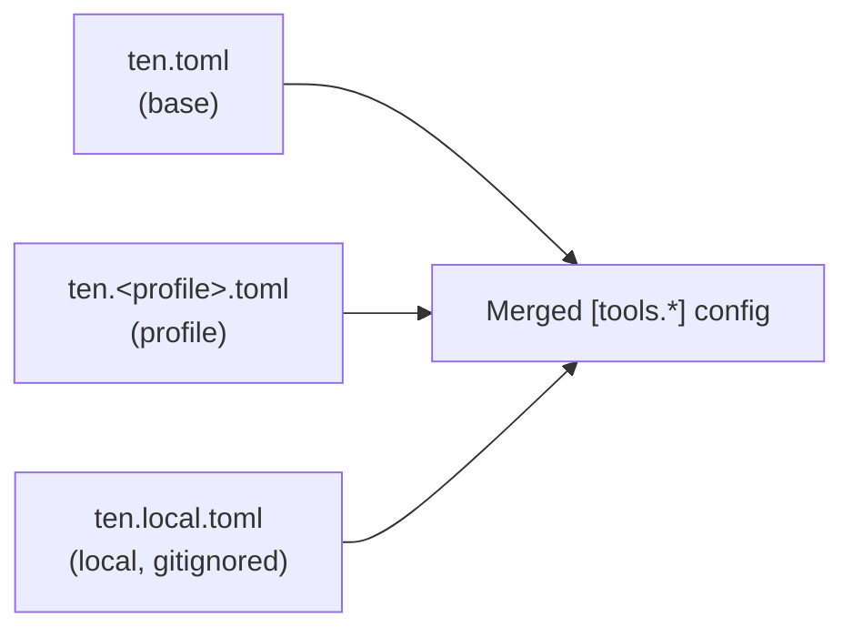

# Configuration reference

English | [日本語](configuration.ja.md)

## Target path prefixes

Keys in `links` / `templates` resolve to absolute paths using one of these prefixes:

- `home:` → under `$HOME`
- `xdg:` → under `$XDG_CONFIG_HOME` (falls back to `$HOME/.config`)

## `[tools.*]`

```toml
[tools.git-work]
enabled    = false                                                   # defaults to true when omitted
depends_on = ["git"]                                                 # applied after its dependencies, in DAG order
links     = { "home:.gitconfig" = "git/.gitconfig" }                 # symlinks
templates = { "home:.gitconfig.local" = "git/gitconfig.local.tmpl" } # rendered via text/template ({{ .Vars.key }} / {{ .Ten.OS }})
before = "echo before"                                                # shell command run before this tool's resources
once   = "echo once"                                                  # shell command run only the first time this tool newly manages a link/template
after  = "echo after"                                                 # shell command run after
```

How `depends_on` orders tools and when each hook runs is described in [How apply works](../concepts/apply.md).

Three safety checks fail an apply up front:

- **Undefined template variables are an error.** A template referencing a `.Vars` key no layer defines fails instead of silently writing `<no value>` into the target. This includes `{{ if .Vars.optional }}` on an undeclared key — declare the key (even as an empty string) in some layer to branch on it.
- **Duplicate targets are an error.** Two entries resolving to the same target path — from different tools, or from one tool's `links` and `templates` — are rejected, naming both claimants.
- **Nested targets are an error.** A target may not live under another managed target (e.g. `xdg:nvim` linked as a directory plus a template at `xdg:nvim/local.lua`): once the outer target is a symlink into your repo, the inner path would resolve inside the repo itself.

Template output is owner-only by default: a newly created template output file gets mode `0600`, since templates usually carry machine-local values (often secrets) from `vars`. When a template replaces or updates an existing regular file, that file's mode is kept. Output is written atomically (temporary file + rename).

## Template data

Templates are rendered with Go's `text/template`. They can reference two kinds of values:

- `.Vars.*` — variables you define under `[vars]` in any config layer (see [Config layering](#config-layering)).
- `.Ten.*` — values `ten` resolves itself at apply time, rather than ones you define:

| Field | Value |
|---|---|
| `.Ten.OS` | `runtime.GOOS` (e.g. `darwin`, `linux`) |
| `.Ten.Arch` | `runtime.GOARCH` (e.g. `arm64`, `amd64`) |
| `.Ten.Hostname` | the current machine's hostname |
| `.Ten.Home` | resolved `$HOME` |
| `.Ten.Profile` | the active profile (empty string if none) |
| `.Ten.Tool` | name of the `[tools.*]` block the template belongs to |
| `.Ten.DotfilesRoot` | absolute path to the dotfiles repository |

`.Ten.Home`/`.Ten.DotfilesRoot`/`.Ten.Hostname` embed a local absolute path or your machine's hostname, which may contain your OS username — avoid rendering them into files you publish.

```
# ~/dotfiles/ssh/config.tmpl
# generated by ten on {{ .Ten.Hostname }}
{{ if eq .Ten.OS "darwin" -}}
Host *
    UseKeychain yes
{{ end -}}
Host bastion
    IdentityFile {{ .Ten.Home }}/.ssh/id_{{ .Ten.Hostname }}
```

## Config layering

`[tools.*]` definitions are layered `ten.toml` → `ten.<profile>.toml` → `ten.local.toml`:



- **Per-field merge**: a later layer overrides only the fields it actually sets, leaving fields it leaves unset untouched from the earlier layer.
- **`links` / `templates` / `depends_on` replace as a whole**: when a later layer sets one of these fields at all, it replaces the entire field (no per-key merging within a single field).
- **`before` / `once` / `after` treat an empty string as "not set"**: a later layer can't explicitly clear a value set by an earlier layer.
- **Legacy `enabled_tools` is ignored**: a leftover top-level `enabled_tools` key from before this field existed is silently ignored (not an error), so every tool falls back to its default of `enabled = true`. If you're migrating an old config, delete `enabled_tools` and move each tool's on/off state into its own `[tools.*]` block's `enabled` field.

Use `enabled` to turn a tool on or off per layer without repeating its other fields — e.g. define a tool disabled by default in `ten.toml` and flip it on for one profile:

```toml
# ten.toml (common, always loaded)
[tools.git]
links = { "home:.gitconfig" = "git/.gitconfig" }

[tools.git-work]
enabled    = false
depends_on = ["git"]
templates  = { "home:.gitconfig.local" = "git/gitconfig.local.tmpl" }

# ten.work.toml (loaded only when profile = "work")
[tools.git-work]
enabled = true
```

`vars` follows the same base → profile → local layering but merges per variable key rather than per tool: a variable declared in a later layer overrides only that one key, leaving variables declared solely in earlier layers untouched.
